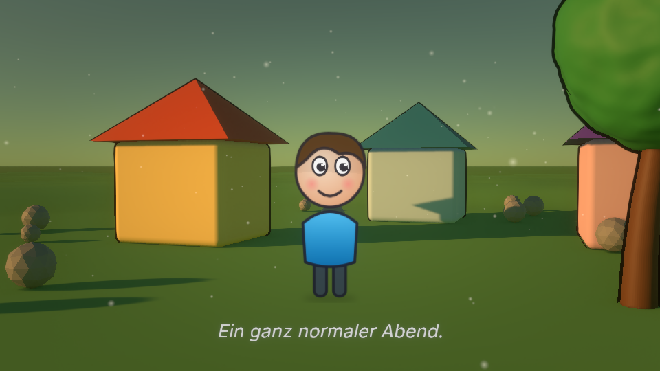
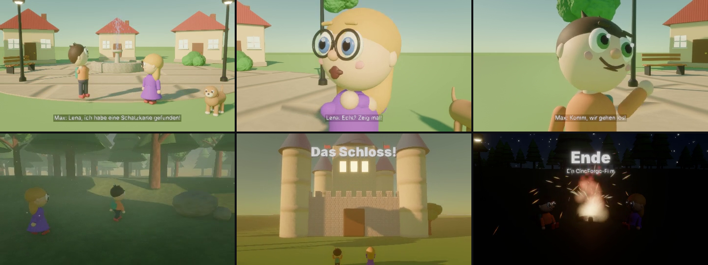
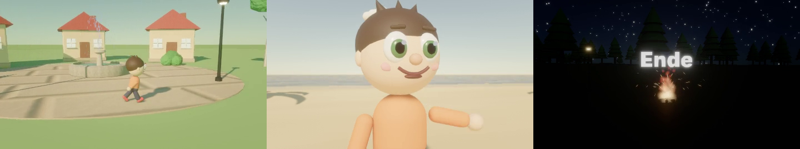
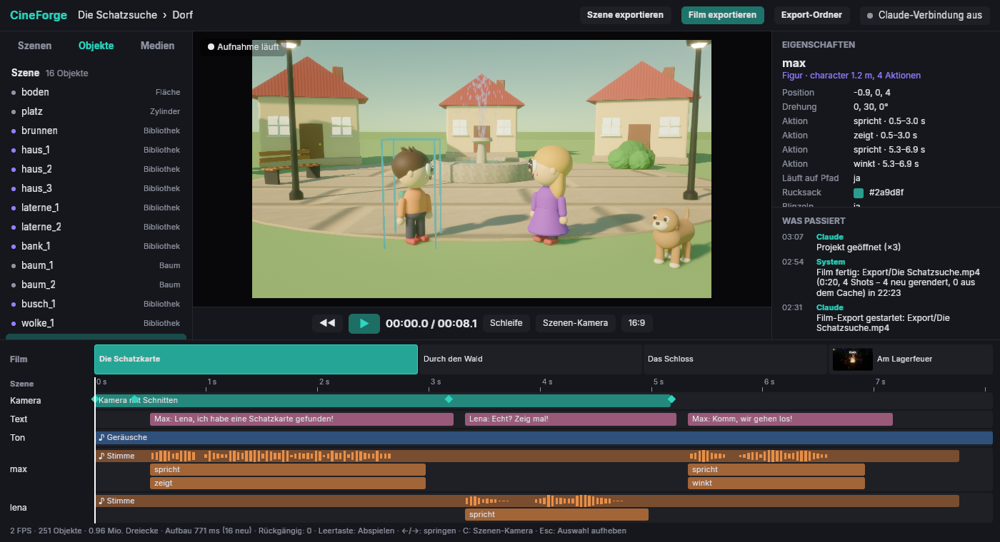

# CineForge Studio

**KI-Video-Studio, in dem Claude mitarbeitet.** Szenen, 3D-Welten, Videos und Filme
entstehen als strukturierte Beschreibung und werden in Echtzeit auf der GPU gerendert,
bis 4K, für macOS und Windows.

> Status: Claude baut und ändert Szenen live in der App, prüft das Ergebnis per Kontrollbild,
> erzeugt eigene Sounds, Musik und 2D-Grafiken und rendert ganze Filme. Siehe [Fahrplan](docs/FAHRPLAN.md).

## Mit Claude arbeiten

App starten, **F2** drücken, Claude Desktop neu starten. Danach zum Beispiel schreiben:
„Bau mir in CineForge eine Unterwasserstadt mit leuchtenden Kuppeln.“
Details: [Claude verbinden](docs/CLAUDE-VERBINDEN.md)



*2D-Figur in einer 3D-Welt – gebaut aus der Szenen-Datei [`scenes/vorzeige.json`](scenes/vorzeige.json).*



*Demo-Film „Die Schatzsuche“ (20 s, 4 Shots), komplett über die Claude-Schnittstelle erzeugt: Dialog mit
Stimmen, Lippen-Sync, Mimik und Schuss/Gegenschuss, Verfolgerkamera im Wald, Titel, Lagerfeuer-Nacht,
Übergänge, Umgebungsgeräusche und Abenteuer-Musik passend zur Filmlänge:
[`docs/bilder/schatzsuche.mp4`](docs/bilder/schatzsuche.mp4)*



*Kurzfilm, komplett über die Claude-Schnittstelle gebaut (Vorlagen, Figur, Stimme, Musik, 3 Shots):
[`docs/bilder/kurzfilm.mp4`](docs/bilder/kurzfilm.mp4)*



## Was Claude damit kann

- **Ganze Filme**: Storyboard mit Shots – alle Szenen in einem Schritt aus 14 fertigen Vorlagen (Wiese,
  Dorf, Wald, Strand, Nacht, Studio, Weltraum, Zimmer, Cartoon-2D, Schloss, Unterwasser, Stadt, Bauernhof,
  Winter), Export bis
  4K und 1 Stunde+, Übergänge (Schnitt, Abblende, Überblendung, Wisch-, Schiebe-, Kreisblende), Qualität
  „best“ mit Supersampling, Zeitlupe/Zeitraffer je Shot, rollender Abspann. **Besetzungsliste**: jede Figur
  einmal festlegen, gleich in allen Szenen. **Film-Übersicht**: alle Shots in einem Bild; **Bildkontrolle**
  rechnet nach, ob Figuren im Bild sind, wenn sie handeln oder sprechen.
- **Figuren im Pixar-Stil** aus einer Zeile: Frisur, Farben, Statur, Kleid, Hut, Brille, Schal, Rucksack,
  Gegenstände in der Hand; 21 Aktionen (gehen, rennen, winken, springen, tanzen, sprechen, klatschen,
  verbeugen, lachen, erschrecken, Schultern zucken, traurig, aufgeregt hüpfen …) mit Zeichentrick-Prinzipien
  (Ausholen, Stauchen & Strecken), 9 Gesichtsausdrücke (auch lachend, begeistert, verschlafen,
  zwinkernd) im Zeitverlauf, 9 Frisuren (auch Pferdeschwanz, Zöpfe, Afro), Blickkontakt, Lippen-Sync,
  Blinzeln, Atmen. Menschenmengen mit lauter Varianten.
- **Tiere**: Hund, Katze, Hase, Vogel, Fisch, Kuh, Schwein, Schaf, Pferd, Huhn – laufen, wedeln, fliegen, schwimmen.
- **Dialoge in einem Schritt**: Stimmen, Timing, Lippen-Sync, Gesten, Mimik je Satz, Untertitel,
  Zweier-Einstellung und Schuss/Gegenschuss nach der 180°-Regel mit sanftem Heranfahren.
- **Ton**: eigene Musik und Geräusche (Synthese, kein KI-Klang), automatische Geräusche zur Handlung
  (Schritte, Hufe, Sprünge, Flügel, Feuer, Regen) und passende Umgebung (Vögel, Grillen, Meer, Bach, Stadt,
  Unterwasser), Musik nach Stimmung (fröhlich, traurig, Abenteuer, spannend, magisch …) genau so lang wie
  der Film, Sprecher mit Systemstimmen, Ton in der Vorschau, Wellenformen in der Zeitleiste.
- **Kamera wie im Film**: Einstellungsgrößen (Totale bis Großaufnahme), Kamerafahrten ohne Rechnen
  (Heranfahren, Bogen, Kran, Push-in), Gruppen-Einstellungen (alle Figuren automatisch im Bild), folgen,
  umkreisen, Schnitte in der Szene, Tiefenschärfe, Bewegungsunschärfe, Handkamera.
- **Licht in einem Wort**: Morgen, Mittag, goldene Stunde, Sonnenuntergang, blaue Stunde, Nacht, bewölkt,
  magisch, unheimlich.
- **Welten**: Gelände, Bäume (5 Arten, Wind, Wälder), Wasser mit Wellen, Sternenhimmel, Mond,
  Lichtstrahlen, Nebel, Partikel (Feuer, Rauch, Funken, Regen, Schnee, Explosion, Magie), 12 fertige
  Bibliotheks-Objekte (Haus, Auto, Laterne, Brunnen …).
- **Detaillierte Modelle**: Extrusion, Drehkörper, Röhren, 3D-Text, Abrunden/Unterteilen, Verformen
  (verdrehen, biegen, Rauschen), Muster mit Struktur, Glas, Metall, Cartoon-Umrisse; Import von
  PNG, SVG und 3D-Modellen (GLB/glTF).
- **2D**: SVG-Grafiken in voller Qualität (Verläufe, Schatten, Text), 2D-Kamera, Cartoon-Farbstil,
  2D-Figuren als „Pappaufsteller“ in 3D-Welten.
- **Robust**: Stürzt die App ab, startet sie beim nächsten Mal im sicheren Modus und nennt den Grund;
  unfertige (schwarze) Kontrollbilder werden automatisch wiederholt.
- **Schnell und sicher**: Fehlermeldungen mit genauer Stelle und Lösungsvorschlag, Änderungen ohne
  Neuladen, mehrere Claude-Agenten parallel, Logbuch zum Weitermachen nach Pausen.

## Die Oberfläche

Aufgebaut wie ein Schnittprogramm (ähnlich CapCut):

- **Oben:** Projekt › Szene, Knöpfe **Szene exportieren**, **Film exportieren**, **Abbrechen** (während
  eines Exports), **Export-Ordner** (öffnet den Ordner mit den fertigen Videos) und ob Claude verbunden ist.
- **Links:** *Szenen* (Storyboard, Klick öffnet die Szene), *Objekte* (alle Teile der Szene,
  Klick wählt aus), *Medien* (Audio, Clips, Bilder, 3D-Modelle des Projekts).
- **Mitte:** die Vorschau. Ein Klick auf ein Objekt wählt es aus und rahmt es ein –
  Claude weiß dann, was du mit „das hier“ meinst. Darunter Abspielen, Zeit, Schleife,
  Szenen-/freie Kamera und 16:9 / 9:16 (Hochformat für TikTok/Reels). Beim Abspielen hört man
  den Ton des Shots (Stimmen, Geräusche, Musik) synchron zum Bild. Exporte übernehmen das gewählte Format.
- **Rechts:** *Eigenschaften* des ausgewählten Objekts (oder der Szene) mit Knöpfen zum Selbst-Bearbeiten:
  Farbpalette, verschieben, drehen, größer/kleiner, duplizieren, verstecken, löschen, rückgängig.
  Darunter *Was passiert* – was Claude gerade gemacht hat und der nächste Schritt.
- **Unten:** die Zeitleiste. Oben alle Shots des Films (mit Vorschaubild), darunter die Spuren der geöffneten
  Szene: Kamera, Texte, Ton (mit Wellenform) und jedes animierte Objekt mit seinen Aktionen und Keyframes (◆).
  Klicken oder Ziehen springt an die Stelle.

## Ausprobieren

### Mac: selbst bauen (kostenlos, immer die neueste Version)

1. Auf GitHub im Projekt oben auf den grünen Knopf **Code → Download ZIP** klicken.
2. Die ZIP-Datei im Ordner *Downloads* doppelklicken (es entsteht der Ordner `cineforge-main`).
3. Das Programm **Terminal** öffnen (Spotlight: ⌘ + Leertaste, „Terminal“ tippen) und diese Zeile
   hineinkopieren, dann Enter:

   ```bash
   cd ~/Downloads/cineforge-main && bash packaging/macos/selbst-bauen.sh
   ```

   Beim allerersten Mal fragt Apple nach den „Entwickler-Werkzeugen“ → *Installieren*, danach die
   Zeile noch einmal ausführen. Der erste Bau dauert 10–20 Minuten, dann startet CineForge von selbst
   aus dem Programme-Ordner – ohne „Trotzdem öffnen“. **Update:** alten Ordner `cineforge-main` in den
   Papierkorb, neue ZIP laden und entpacken, Zeile erneut ausführen (dauert dann nur noch wenige Minuten).

### Fertige Version von GitHub

1. Auf GitHub unter **Actions → Build → letzter Lauf** ganz unten unter *Artifacts*
   `CineForge-macOS` oder `CineForge-Windows` herunterladen und entpacken.
2. **Mac:** `CineForge.app` in den Programme-Ordner ziehen und doppelklicken.
   Solange die App noch nicht mit deinem Apple-Developer-Zertifikat signiert ist,
   meldet macOS beim ersten Start „kann nicht geöffnet werden“. Dann:
   *Systemeinstellungen → Datenschutz & Sicherheit → ganz unten „Trotzdem öffnen“*.
   Alternativ im Terminal: `xattr -dr com.apple.quarantine /Applications/CineForge.app`
3. **Windows:** `CineForge.exe` starten (bei der SmartScreen-Warnung „Weitere
   Informationen → Trotzdem ausführen“).

Beim ersten Start legt die App das Demo-Projekt unter
`Dokumente/CineForge/Projekte/Demo/` an und öffnet die Szene `Szenen/wueste.json`.
Danach öffnet sie immer die zuletzt bearbeitete Szene.
**Öffne diese Datei in einem Texteditor, ändere z. B. `"elevation": 7` auf `40`,
speichere – die Welt ändert sich sofort.**

### Steuerung

| Eingabe | Aktion |
|---|---|
| Linke Maustaste in der Vorschau | Objekt auswählen |
| Rechte Maustaste halten + Maus | Umschauen (Maus über der Vorschau) |
| W A S D | Fliegen |
| E / Q | Hoch / Runter |
| Shift | Schneller |
| Mausrad | Fluggeschwindigkeit |
| C | Zurück zur Szenen-Kamera |
| R | Szene neu laden |
| Esc | Auswahl aufheben |
| F12 | Bild der Vorschau speichern (landet in `Dokumente/CineForge/Screenshots`) |
| Cmd/Strg + Z | Rückgängig (auch Änderungen von Claude) |
| F2 | Mit Claude Desktop verbinden |
| Leertaste | Animation abspielen / pausieren |
| ← / → (mit Shift feiner) | 1 s (0,1 s) springen |
| Pos1 / Ende | Anfang / Ende |
| L | Schleife an/aus |
| V | Durch die Szenen-Kamera schauen (Kamerafahrt) |
| JSON-Datei ins Fenster ziehen | Andere Szene öffnen |

## Video-Export

Claude exportiert mit `export_video` (eine Szene) oder `export_film` (ganzer Film, auch
1 Stunde+, mit Ton und Video-Clips) in `Dokumente/CineForge/Projekte/<Projekt>/Export/`.

**ffmpeg** (für Video und Ton) ist ab der aktuellen Version in der App enthalten. Falls nicht:
Mac `brew install ffmpeg`, Windows `winget install ffmpeg`. Die App nutzt automatisch den
Hardware-Encoder (Mac: VideoToolbox, Windows: NVIDIA/Intel/AMD).

**Eigene Medien** legst du in den Projektordner: `Audio/` (Musik, Geräusche, Stimmen),
`Clips/` (Videos, z. B. KI-Videos oder Handy-Aufnahmen), `Bilder/` (Logos, Fotos).

## Für Entwickler

```bash
cargo run -p cineforge-studio -- scenes/wueste.json
cargo run -p cineforge-studio -- scenes/wueste.json --screenshot bild.png --size 1920x1080
cargo test --workspace
```

- [Claude verbinden](docs/CLAUDE-VERBINDEN.md)
- [Architektur](docs/ARCHITEKTUR.md)
- [Szenen-Format](docs/SZENEN-FORMAT.md)
- [Fahrplan](docs/FAHRPLAN.md)
- [Mac-Signierung einrichten](docs/RELEASE.md)
