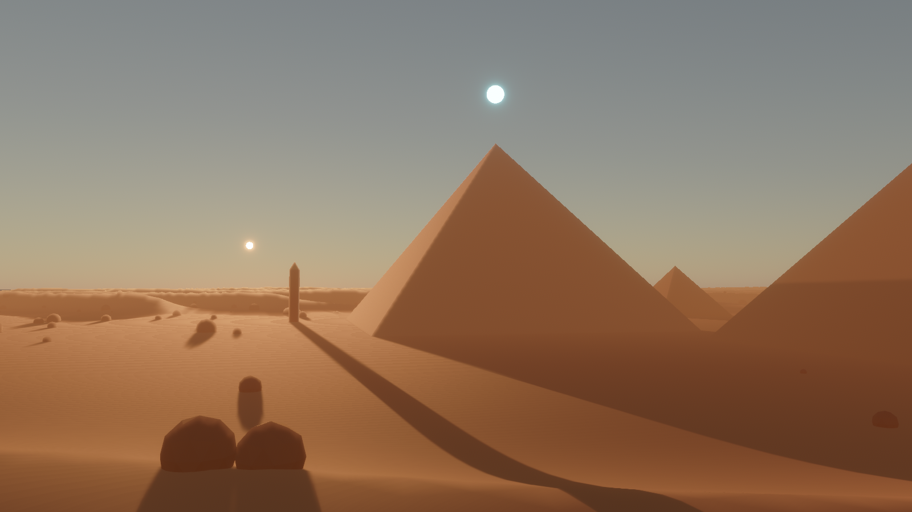

# CineForge Studio

**KI-Video-Studio, in dem Claude mitarbeitet.** Szenen, 3D-Welten, Videos und Filme
entstehen als strukturierte Beschreibung und werden in Echtzeit auf der GPU gerendert,
bis 4K, für macOS und Windows.

> Status: **Etappe 2** – Claude ist verbunden: Es baut und ändert Szenen live in der
> App und prüft das Ergebnis per Kontrollbild. Siehe [Fahrplan](docs/FAHRPLAN.md).

## Mit Claude arbeiten

App starten, **F2** drücken, Claude Desktop neu starten. Danach zum Beispiel schreiben:
„Bau mir in CineForge eine Unterwasserstadt mit leuchtenden Kuppeln.“
Details: [Claude verbinden](docs/CLAUDE-VERBINDEN.md)



## Ausprobieren

1. Auf GitHub unter **Actions → Build → letzter Lauf** ganz unten unter *Artifacts*
   `CineForge-macOS` oder `CineForge-Windows` herunterladen und entpacken.
2. **Mac:** `CineForge.app` in den Programme-Ordner ziehen und doppelklicken.
   Solange die App noch nicht mit deinem Apple-Developer-Zertifikat signiert ist,
   meldet macOS beim ersten Start „kann nicht geöffnet werden“. Dann:
   *Systemeinstellungen → Datenschutz & Sicherheit → ganz unten „Trotzdem öffnen“*.
   Alternativ im Terminal: `xattr -dr com.apple.quarantine /Applications/CineForge.app`
3. **Windows:** `CineForge.exe` starten (bei der SmartScreen-Warnung „Weitere
   Informationen → Trotzdem ausführen“).

Beim ersten Start legt die App das Demo-Projekt unter
`Dokumente/CineForge/Projekte/Demo/` an und öffnet die Szene `Szenen/wueste.json`.
Danach öffnet sie immer die zuletzt bearbeitete Szene.
**Öffne diese Datei in einem Texteditor, ändere z. B. `"elevation": 7` auf `40`,
speichere – die Welt ändert sich sofort.**

### Steuerung

| Eingabe | Aktion |
|---|---|
| Rechte Maustaste halten + Maus | Umschauen |
| W A S D | Fliegen |
| E / Q | Hoch / Runter |
| Shift | Schneller |
| Mausrad | Fluggeschwindigkeit |
| C | Zurück zur Szenen-Kamera |
| R | Szene neu laden |
| H | Infos ein-/ausblenden |
| F12 | Screenshot (landet in `Dokumente/CineForge/Screenshots`) |
| Cmd/Strg + Z | Rückgängig (auch Änderungen von Claude) |
| F2 | Mit Claude Desktop verbinden |
| Leertaste | Animation abspielen / pausieren |
| ← / → (mit Shift feiner) | 1 s (0,1 s) springen |
| Pos1 / Ende | Anfang / Ende |
| L | Schleife an/aus |
| V | Durch die Szenen-Kamera schauen (Kamerafahrt) |
| JSON-Datei ins Fenster ziehen | Andere Szene öffnen |

## Video-Export

Claude exportiert mit `export_video` (bis 4K) in `Dokumente/CineForge/Projekte/<Projekt>/Export/`.
Dafür wird **ffmpeg** benötigt (kostenlos):
- Mac: Homebrew installieren (brew.sh), dann im Terminal `brew install ffmpeg`
- Windows: `winget install ffmpeg`

Die App findet ffmpeg automatisch und nutzt den Hardware-Encoder (Mac: VideoToolbox,
Windows: NVIDIA/Intel/AMD). Ohne ffmpeg werden die Einzelbilder als PNG gespeichert.

## Für Entwickler

```bash
cargo run -p cineforge-studio -- scenes/wueste.json
cargo run -p cineforge-studio -- scenes/wueste.json --screenshot bild.png --size 1920x1080
cargo test --workspace
```

- [Claude verbinden](docs/CLAUDE-VERBINDEN.md)
- [Architektur](docs/ARCHITEKTUR.md)
- [Szenen-Format](docs/SZENEN-FORMAT.md)
- [Fahrplan](docs/FAHRPLAN.md)
- [Mac-Signierung einrichten](docs/RELEASE.md)
